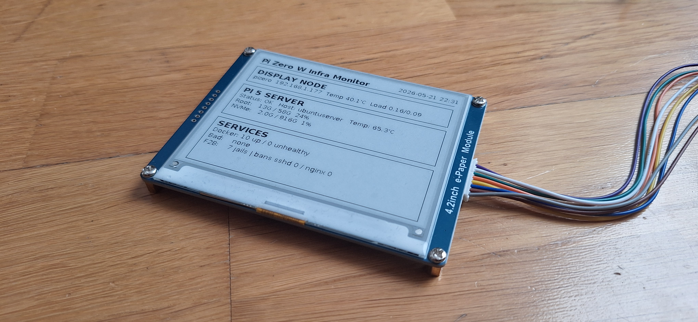
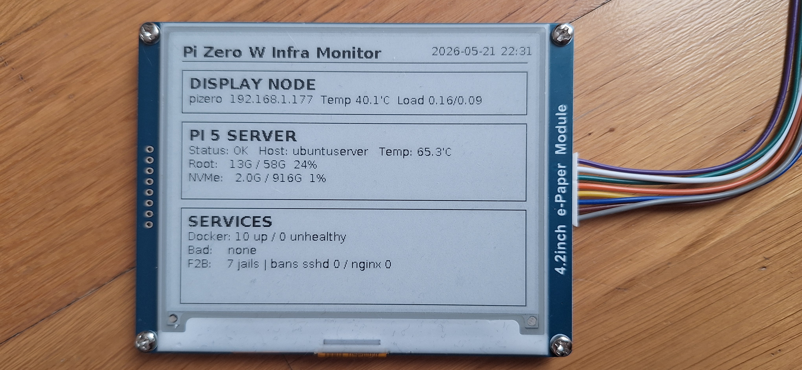
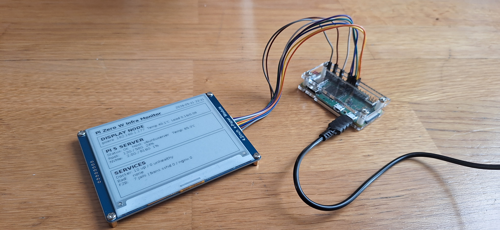
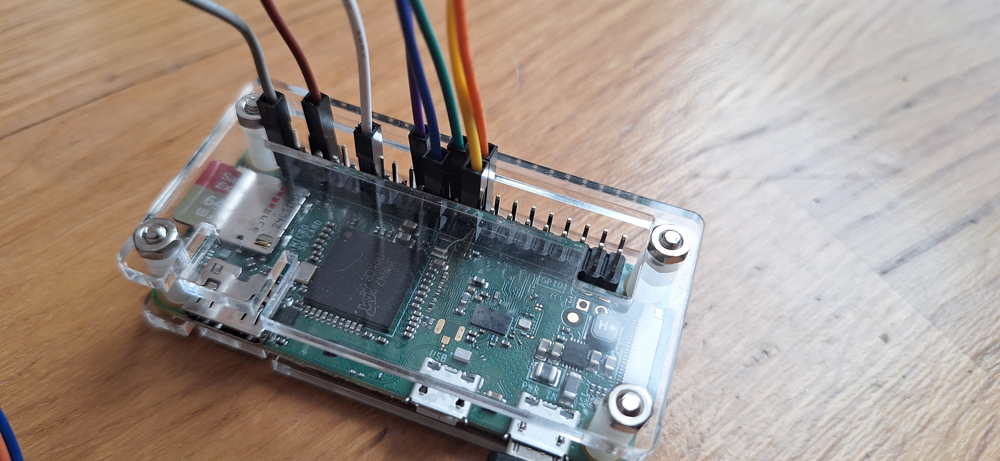

# Raspberry Pi Zero W e-Paper Infrastructure Monitor



Low-power infrastructure monitoring appliance built with:
-Raspberry Pi Zero W
-Waveshare 4.2" e-paper display
-Python
-SSH-based remote telemetry
-Docker monitoring
-Fail2ban monitoring
The device acts as a lightweight always-on display node for self-hosted infrastructure.

## Features

- Raspberry Pi Zero W with Waveshare 4.2" e-paper display
- Raspberry Pi 5 telemetry over SSH
- Remote CPU temperature and filesystem monitoring
- Root filesystem and NVMe usage monitoring
- Raspberry Pi 4 DHT22 temperature and humidity monitoring
- DHT22 measurements retrieved through an HTTPS JSON API
- Last successful DHT22 measurement cached locally
- ONLINE, STALE and OFFLINE sensor status indicators
- Last successful sensor measurement timestamp
- Automatic dashboard refresh every 300 seconds
- Automatic startup through systemd
- Fully headless operation
- Lightweight telemetry collection

## Screenshots

### Dashboard close-up



### Full setup



### GPIO wiring



## Hardware

### Main Display Node
-Raspberry Pi Zero W
-Waveshare 4.2" e-paper display (Rev 2.1)
-microSD card
-40-pin GPIO connection

### Remote Infrastructure Node
Example monitored server:
-Raspberry Pi 5
-Docker services
-Fail2ban
-NVMe storage

## Documentation

- [Wiring](docs/wiring.md)
- [Troubleshooting](docs/troubleshooting.md)
- [Architecture](docs/architecture.md)
- [Deployment](docs/deployment.md)
- [Lessons Learned](docs/lessons-learned.md)
- [Services](docs/services.md)
- [Storage and Power Considerations](docs/storage-and-power.md)

## Architecture

```text
                      Raspberry Pi Zero W
                    Waveshare 4.2" e-Paper
                              |
                 +------------+------------+
                 |                         |
            SSH telemetry              HTTPS API
                 |                         |
                 v                         v
          Raspberry Pi 5             Raspberry Pi 4
          Infrastructure             Sensor / API Node
                 |                         |
          +------+------+                  |
          |             |                  |
      CPU / Load    Root / NVMe           DHT22
                                      Temperature
                                       Humidity
```

The Raspberry Pi Zero W collects remote infrastructure telemetry from Raspberry Pi 5 over SSH and environmental measurements from Raspberry Pi 4 through an HTTPS JSON API.

The display refreshes every 300 seconds. The last successful DHT22 measurement is cached locally, allowing the dashboard to indicate stale or unavailable sensor data.

The architecture keeps monitoring and display rendering lightweight on the Raspberry Pi Zero W.

## Project Goals

This project was designed to create a lightweight always-on infrastructure monitor with:

- extremely low power usage
- minimal software complexity
- always-visible telemetry
- reliable autonomous operation
- SSH-based remote monitoring
- no browser or web dashboard dependencies

The Raspberry Pi Zero W acts purely as a low-power telemetry appliance.

## Why e-Paper?

E-paper displays are ideal for infrastructure monitoring because:

- the image remains visible without constant refresh
- power usage is extremely low
- there is no backlight
- the display is readable from far away
- refreshes are infrequent in telemetry applications

This makes e-paper suitable for 24/7 monitoring appliances.

## Current Dashboard Data

### Display Node — Raspberry Pi Zero W

- Hostname
- IP address
- CPU temperature
- System load

### Remote Server — Raspberry Pi 5

- Online/offline status
- CPU temperature
- Root filesystem usage
- NVMe storage usage

### Environmental Monitoring — Raspberry Pi 4 / DHT22

- Temperature (°C)
- Relative humidity (%)
- HTTPS JSON API connectivity
- ONLINE, STALE and OFFLINE sensor status
- Last successful measurement timestamp
- Locally cached last successful measurement

Docker and Fail2ban monitoring remain available in the earlier dashboard v6 implementation but are not displayed in the current v7 layout.

## Example Dashboard Layout

The following example illustrates the current dashboard v7 layout on the Waveshare 4.2" e-paper display (400 × 300 pixels).

```text
+------------------------------------------------+
| Pi Zero W Infra Monitor       2026-10-21 20:30 |
|                            DHT22: 20:25        |
+------------------------------------------------+
| DISPLAY NODE                                   |
| Host: pizero              IP: 192.168.x.x      |
| CPU: 40.1 C               Load: 0.15           |
+------------------------------------------------+
| PI 5 SERVER                                    |
| Status: ONLINE                                 |
| CPU: 48.2 C                                    |
| Root: 13G / 58G        NVMe: 2G / 916G         |
+------------------------------------------------+
| RPi 4 / DHT22                                  |
|                                                |
|       22.4 C               45.8 %              |
|                                                |
| Status: ONLINE                                 |
+------------------------------------------------+
```

*Values are illustrative. Actual measurements and status indicators depend on the connected devices and sensor availability.*

The dashboard refreshes every 300 seconds. If the DHT22 API becomes unavailable, the locally cached measurement can be displayed with an appropriate STALE or OFFLINE status.

## Real-World Problems Encountered

This project involved several real-world Raspberry Pi Zero W issues.
These are intentionally documented because they are useful for others building similar systems.

### Wi-Fi Problems
Observed issues:
-rfkill soft blocks
-unstable DNS resolution
-Pi-hole related DNS issues
-Wi-Fi power saving instability
-SSH connection drops during package installation

Fixes included:
-disabling Wi-Fi power saving
-manual DNS configuration
-using Raspberry Pi OS Bullseye 32-bit
-avoiding heavier package operations when unnecessary

### Waveshare Driver Problems
The first selected Waveshare V2 driver locked permanently at:

DEBUG:waveshare_epd.epd4in2_V2:e-Paper busy

The issue was resolved by switching to the older compatible driver version.
This was especially important because:
-the display hardware revision was older
-newer Waveshare drivers were not fully compatible

## SSH Timing During Boot
After reboot:
-the Pi Zero dashboard service started faster than the remote server SSH service
-the first telemetry query failed temporarily
The dashboard was designed to recover automatically during the next refresh cycle.

### Lessons Learned
-Raspberry Pi Zero W is fully capable as a lightweight telemetry appliance
-e-paper displays are excellent for always-on infrastructure monitoring
-single-query SSH telemetry is much more stable than multiple SSH calls
-real-world networking issues matter more than raw CPU performance
-lightweight architectures are critical on low-power ARM devices

### Future Improvements
Planned improvements:
-partial refresh support
-better fonts and icons
-graph rendering
-multiple remote hosts
-historical statistics
-VPN monitoring
-last successful update timestamp
-last unhealthy container names

## Repository Contents

```text
dashboard/
├── dashboard_remote_v7.py    # Current dashboard (SSH + DHT22)
├── dashboard_remote_v6.py    # Previous dashboard (Docker + Fail2ban)
├── dashboard_loop.py         # Dashboard refresh loop
└── epaper-dashboard.service  # systemd service
```

Dashboard v7 is the current implementation. Dashboard v6 is retained for reference and contains the earlier Docker and Fail2ban monitoring functionality.

The dashboard refresh loop executes v7 automatically every 300 seconds through the systemd service.

## Code Example

### Dashboard Refresh Loop

The dashboard is refreshed automatically every 300 seconds using `dashboard_loop.py` and a systemd service.

The current implementation executes:

```python
subprocess.run(
    ["/usr/bin/python3", "/home/hmasi/waveshare_epaper/dashboard_remote_v7.py"]
)
```

The refresh loop is managed by `epaper-dashboard.service`, allowing the display to operate autonomously after boot.

### Raspberry Pi 5 Telemetry

Dashboard v7 collects remote infrastructure telemetry from Raspberry Pi 5 over SSH.

The monitored data includes CPU temperature, root filesystem usage, NVMe storage usage and server availability.

The remote SSH target is configurable through the `EPAPER_REMOTE_HOST` environment variable:

```bash
export EPAPER_REMOTE_HOST="pi@raspberrypi.local"
```

Replace the example hostname and username with those of your monitored server.

### Raspberry Pi 4 DHT22 Monitoring

Temperature and humidity readings are retrieved from an HTTPS JSON API running on Raspberry Pi 4.

The API endpoint is configurable through the `EPAPER_DHT22_URL` environment variable:

```bash
export EPAPER_DHT22_URL="https://example.com/api/lab_temp"
```

Replace the example URL with your actual API endpoint.

Dashboard v7 stores the last successful DHT22 reading locally and uses ONLINE, STALE and OFFLINE indicators to communicate sensor availability.

### Configuration Notes

Environment variables must be available to the dashboard process. When running the dashboard through systemd, configure them in the service environment rather than relying on variables exported in an interactive SSH session.

The repository uses example defaults instead of hardcoded private network addresses.

Example remote telemetry collection:

```python
cmd = (
    "hostname; "
    "vcgencmd measure_temp; "
    "df -h /; "
    "docker ps --format '{{.Names}}' | wc -l"
)
```

The final implementation intentionally uses a single SSH session for lightweight telemetry collection.

## Current Version

**v1.1 — In preparation**

The v1.1 release introduces dashboard v7, adding environmental monitoring through a Raspberry Pi 4 DHT22 sensor and an HTTPS JSON API.

The previous v1.0 release introduced the core e-paper infrastructure monitoring functionality.

### Included Features

- Raspberry Pi Zero W with Waveshare 4.2" e-paper display
- Raspberry Pi 5 infrastructure monitoring over SSH
- Remote CPU temperature and filesystem usage
- Root filesystem and NVMe storage monitoring
- Raspberry Pi 4 DHT22 temperature and humidity monitoring
- HTTPS JSON API integration
- Local caching of the last successful sensor measurement
- ONLINE, STALE and OFFLINE sensor status indicators
- Last successful DHT22 measurement timestamp
- Automatic refresh every 300 seconds
- Automatic startup through systemd
- Fully headless operation
- Previous dashboard v6 retained for Docker and Fail2ban monitoring

### Planned Future Improvements

**Environmental Monitoring**

- WeatherHub COSY BARO (TFA Dostmann 35.1154.01) indoor temperature, humidity and barometric pressure monitoring
- Experimental 868 MHz WeatherHub data reception using an RTL-SDR USB receiver connected to Raspberry Pi 4
- RuuviTag Bluetooth Low Energy sensor for outdoor temperature, humidity and atmospheric pressure monitoring on a balcony
- Integration of additional sensor readings into the Raspberry Pi 4 API
- Multi-sensor dashboard layouts for the Waveshare 400 × 300 e-paper display

**Dashboard and Infrastructure**

- Partial e-paper refresh support
- Improved typography and icons
- Graphical telemetry and historical statistics
- Multiple remote infrastructure hosts
- VPN monitoring
- Additional dashboard layouts or rotating information pages
- Improved configuration and deployment documentation

WeatherHub reception and protocol compatibility are still experimental. RuuviTag integration is planned and not yet implemented.

## Status

**Project status:** Actively developed

**Current implementation:** Dashboard v7

**Next release:** v1.1 (in preparation)

The current dashboard monitors Raspberry Pi 5 infrastructure telemetry over SSH and Raspberry Pi 4 DHT22 measurements through an HTTPS JSON API.

The Raspberry Pi Zero W operates as a standalone e-paper monitoring appliance with automatic systemd startup and a 300-second refresh interval.

The previous dashboard v6 implementation remains available in the repository for reference, including Docker and Fail2ban monitoring.

The next development phase focuses on additional environmental sensors and multi-sensor dashboard support.

### License
MIT License
